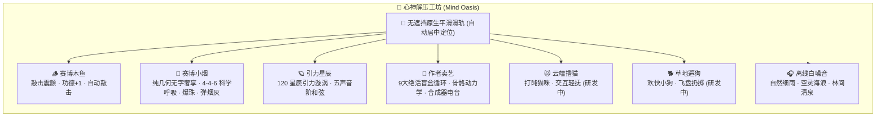

# 脉律 PulseFlow - 科学精力日程与心神解压工坊

<p align="center">
  
</p>

<p align="center">
  <b>顺应生物节律 · 单线程深度攻坚 · 沉浸感官微憩</b><br/>
  专为高负荷工作者、高校研博与工程师量身打造的高质感、纯粹、理性的科学精力管理与身心调节应用。
</p>

<p align="center">
  <a href="./README_EN.md">English Documentation</a> | <b>简体中文</b>
</p>

<p align="center">
  
  
  
  
  
  
  
</p>

---

## 📱 立即体验与安装使用（3 种便捷方式）

您无需复杂的本地 Android 编译环境，即可在今日立即上手安装和体验 PulseFlow：

### 方案 A：手机 / 电脑 1 秒安装（推荐，PWA 渐进式应用）
脉律已完整配置 PWA 标准规范（`WebManifest`、离线常驻与视口自适应），支持全平台免安装包秒级安装：
1. **手机端（Android Chrome / Edge / 三星浏览器 / iOS Safari）**：
   - 打开部署地址（或本地服务局域网地址 `http://<电脑IP>:5173`）；
   - 点击浏览器菜单栏的 **「添加到主屏幕」** 或 **「安装应用」**；
   - 手机桌面将立即生成独立 App 图标，点击即可享受全屏、沉浸式、无浏览器顶底栏的原生应用体验！
2. **电脑端（Chrome / Edge）**：
   - 地址栏右侧点击 **「安装 脉律 PulseFlow」** 图标，即可作为独立窗口桌面 App 运行。

---

### 方案 B：Android APK 安装包（GitHub Actions 自动化编译）
本项目已内置 GitHub Actions CI/CD 流水线（`.github/workflows/android-apk.yml`）：
1. 代码推送到您的 GitHub 仓库后，GitHub 将自动启动云端 Ubuntu 容器执行 Gradle 编译；
2. 编译完成后，前往您仓库的 **Actions** 标签页，点击最新的工作流运行，在 **Artifacts（构件）** 区域即可直接下载 `PulseFlow-Android-APK`（包含 `PulseFlow-v1.0.0-debug.apk`）；
3. 将 APK 发送至手机安装即可原生畅玩（支持系统级触觉反馈与防冻结后台计时）。

---

### 方案 C：本地运行与开发
```bash
# 1. 克隆并安装依赖
npm install

# 2. 启动开发服务器（支持局域网真机调试）
npm run dev -- --host 0.0.0.0 --port 5173

# 3. 运行自动化测试套件（10/10 项验证）
npm test

# 4. 构建 Web 生产包并同步至 Android 工程
npm run build:android

# 5.（可选）在 Android Studio 中打开并调试
npm run open:android
```

---

## ⚡ 核心架构与功能一览

### 1. 📅 昼夜节律排期与认知时段 (Circadian Agenda)
- **战略优先级体系**：
  - `P0 核心攻坚`：高认知负荷产出（核心算法推导、顶会论文写作、核心架构交付）；
  - `P1 稳步推进`：关键业务协同、常规测试、文献综述；
  - `P2 弹性机动`：低脑力开销琐碎事项。
- **四大生物钟时段**：
  - **🌅 晨光唤醒 (06:00 - 09:30)**：延缓咖啡因摄入，重置视交叉上核生物钟；
  - **⚡ 深度认知心流 (09:30 - 13:00)**：遵循 90m 超昼夜节律脉冲，单线程攻克核心交付；
  - **🍃 午后稳态推进 (13:00 - 18:00)**：离桌进食、NSDR 快充、防久坐舒展；
  - **🌙 晚间离线修复 (18:00 - 24:00)**：物理断网断联，保障深度睡眠与神经修复。

---

### 2. 🍃 心神解压工坊 (Mind Oasis)
告别说教式鸡汤与繁复说辞，以物理算法与原生触觉带来极简沉浸的感官微憩：



- **🪵 赛博木鱼**：实木音效、击槌力学回弹、爆星粒子动效，支持自定义祈福词（功德 +1 / 头发 +1 / Bug -1）与自动敲击。
- **🚬 赛博小烟（纯几何无字奢享版）**：
  - **零文字严格合规**：烟盒外壳、翻盖、内衬金箔及香烟管体无任何文字标识，纯采用几何、巴洛克与 Art Deco 矢量饰纹；
  - **5 款预烘焙奢华烟盒**：曜石金芒、朱砂青海波、极光冰晶（含爆珠）、翡翠陀飞轮、钛金霓虹（含双爆珠）；
  - **4 款高精机械打火机**：便利店1元塑料机（双腔液态丁烷）、皇家鎏金朗声机（3180Hz 晶莹 CLING♪ 朗声开盖）、三孔防风直冲机（压电电弧+马赫环射流火）、古董黄铜煤油机；
  - **科学呼吸律动**：4.0 秒深吸（烟头炽红升温） $\to$ 4.0 秒稳态屏息 $\to$ 6.0 秒慢呼吐雾，引导环黄金比例下移；
  - **物理操作**：支持捏破爆珠、弹烟灰与抽新烟盲盒随机切换。
- **🪐 引力星辰**：120 颗微粒引力汇聚与流转，手指滑动实时牵引粒子星轨，触发 Solfeggio 五声音阶和弦共振。
- **🎪 作者卖艺（纯享盲盒版）**：
  - 9 大绝活多阶段盲盒循环表演：赛博二胡《二泉映月2077》、重金属电吉他 Solo、全息爵士萨克斯、五球矩阵杂耍、双头激光火棍、独轮车顶碗、街舞 Breaking、机械激光舞、光污染打Call；
  - 纯原生 Canvas 正向动力学骨骼引擎（FK）与残影动效；
  - 纯 Web Audio 程序化合成器音频（投币清脆声、失真吉他、低音律动与琶音）；
  - 视口下沉优化，彻底避免动作穿顶。
- **🐱 云端撸猫 & 🐕 草地遛狗**：轻量微交互伴侣模块（持续演进中）。
- **🎧 离线自然白噪音**：自然细雨、空灵海浪、夏林清泉，纯浏览器端 Web Audio 实时数字合成，无网络依赖，零流量消耗。

---

### 3. 🫁 深度聚焦与神经恢复 (Focus & Restore)
- **4-7-8 脑雾清理呼吸**：吸气 4s ➔ 屏息 7s ➔ 慢呼 8s，抑制交感神经亢奋；
- **NSDR 神经低功耗快充**：10~20 分钟闭目身体扫描，快速补充前额叶能量；
- **90m 超昼夜脉冲计时**：匹配大脑活动天然峰值，与任务精准挂钩；
- **息屏与后台防冻结**：基于真实系统时间戳物理差值计算，锁屏唤醒瞬间毫秒级校准真实剩余时间。

---

### 4. 📊 状态维护微习惯与周报导出
- **近 7 日状态微矩阵**：每张习惯卡片直观呈现近 7 天坚持轨迹，今日高亮脉冲环；
- **📋 一键导出导师周报 / 团队 Standup 简报**：一键生成格式规范的 Markdown 简报，直接复制至微信、邮件或协同文档；
- **脑力荷电量评估**：1~5 级记录当日认知电量与复盘笔记。

---

### 5. 🤖 AI 大模型智能排期导入
- 提供经过认知科学严格校准的 Prompt 模板；
- 鲁棒解析器：支持 JSON 代码块提取与纯文本时间行回退识别（如 `09:30 - 11:00 文献精读 | 科研 | P0`）；
- 智能识别汉字分类并映射，提供勾选预览后再写入日程。

---

### 6. 🌐 完整中英双语与原生触觉反馈
- 顶部导航栏提供一键 `中 / EN` 切换，322 对中英双语键位严格对齐并经自动化测试保证；
- 深度集成 `@capacitor/haptics`，事项勾选、打火机点火、捏破爆珠、呼吸节点均有差异化振动反馈。

---

## 🛠️ 项目工程结构

```
chrono_routine/
├── .github/workflows/          # GitHub Actions CI/CD 流水线
│   ├── android-apk.yml         # 自动编译 Android APK 并发布 Artifact/Release
│   └── deploy-pages.yml        # 自动部署 Web 应用至 GitHub Pages
├── android/                    # Capacitor 原生 Android 工程源码
│   ├── app/src/main/
│   │   ├── AndroidManifest.xml # 安卓清单与系统权限配置
│   │   └── res/                # 启动图、图标及资源
│   └── gradlew                 # Gradle 构建脚本
├── public/
│   ├── favicon.svg             # 矢量应用图标
│   └── manifest.webmanifest    # PWA 安装清单配置
├── src/
│   ├── components/
│   │   ├── AgendaTab/          # 昼夜节律日程排期与 AI 导入
│   │   ├── FocusTab/           # 深度聚焦、4-7-8 呼吸、离线白噪音
│   │   │   ├── MindOasis.tsx        # 心神解压工坊主容器与原生滑轨
│   │   │   ├── CyberSmokeLuxury.tsx # 赛博小烟纯几何无字奢享版
│   │   │   └── CyberBuskingGame.tsx # 作者卖艺火柴人盲盒舞台
│   │   ├── HabitsTab/          # 状态维护微习惯与近 7 日微矩阵
│   │   └── StatsTab/           # 今日交付指数与导师周报导出
│   ├── i18n/
│   │   ├── LanguageContext.tsx # 双语响应式上下文
│   │   └── translations.ts     # 322 对严格校验的双语字典
│   ├── services/
│   │   ├── sound.ts            # Web Audio 程序化声音合成引擎
│   │   ├── haptics.ts          # Capacitor 原生触觉反馈
│   │   └── storage.ts          # 本地 LocalStorage 持久化存储
│   ├── App.tsx                 # 根组件与手势导航
│   └── main.tsx                # 应用入口
├── capacitor.config.ts         # Capacitor 移动端配置
├── package.json
├── test-suite.js               # 10 项全自动回归测试套件
└── vite.config.ts              # Vite 相对路径与打包配置
```

---

## 🧪 自动化测试验证

运行内置全自动化测试套件：
```bash
npm test
```
包含以下 10 项核心严苛验证：
- `[Test 1]` 昼夜节律日期边界与跨月跨年计算
- `[Test 2]` 科研/职场排期激活与独立完成状态测试
- `[Test 3]` 4-7-8 呼吸算法闭包状态切换与防死锁测试
- `[Test 4]` 精力与产出指数加权计算测试
- `[Test 5]` 计时器后台与息屏防冻结时间差计算测试
- `[Test 6]` 导师周报 / 团队 Standup 格式化测试
- `[Test 7]` 排期多维检索与类别即时过滤测试
- `[Test 8]` 习惯近 7 日状态矩阵算法测试
- `[Test 9]` AI 大模型排期字符串识别与容错解析测试
- `[Test 10]` 中英文双语词典对齐与完整性测试（322 对术语完全对齐）

---

## 📄 开源许可证

本项目基于 [MIT License](./LICENSE) 开源发布。
欢迎体验、Star、提交 Issue 与 Pull Request！
