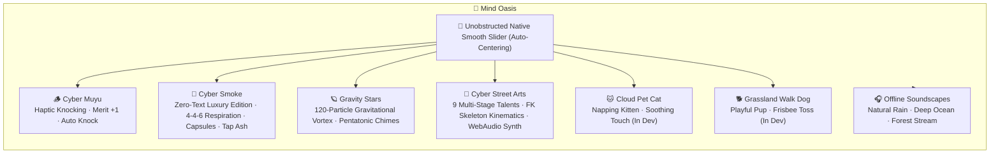

# PulseFlow - Circadian Energy Scheduler & Mind Oasis

<p align="center">
  
</p>

<p align="center">
  <b>Harmonize with Circadian Rhythms · Single-Threaded Deep Work · Sensory Micro-Rest</b><br/>
  A minimalist, rational, high-texture energy management and sensory decompression app designed for researchers, postgraduates, and engineers.
</p>

<p align="center">
  <b>English Documentation</b> | <a href="./README.md">简体中文</a>
</p>

<p align="center">
  
  
  
  
  
  
  
</p>

---

## 📱 Quick Start & Installation (3 Convenient Options)

You can install and use PulseFlow today on your phone or computer without needing a local Android development setup:

### Option A: 1-Click PWA Installation (Recommended)
PulseFlow is fully configured as a Progressive Web App (PWA) with `WebManifest`, offline capabilities, and viewport optimization:
1. **On Mobile (Android Chrome / Edge / Samsung Internet / iOS Safari)**:
   - Open your deployed URL (or local LAN address `http://<your-ip>:5173`);
   - Tap your browser's menu and select **"Add to Home Screen"** or **"Install App"**;
   - An independent App icon will appear on your home screen. Open it for a full-screen, native-feeling app experience without any browser bars!
2. **On Desktop (Chrome / Edge)**:
   - Click the **"Install PulseFlow"** button in the address bar to run it in a standalone window.

---

### Option B: Android APK Package (GitHub Actions Automated Build)
This project includes a ready-to-use GitHub Actions CI/CD workflow (`.github/workflows/android-apk.yml`):
1. Push your code to your GitHub repository;
2. GitHub automatically launches a cloud Ubuntu container to execute the Gradle build;
3. Go to the **Actions** tab in your repository, click the latest workflow run, and scroll down to **Artifacts** to download `PulseFlow-Android-APK` (which contains `PulseFlow-v1.0.0-debug.apk`);
4. Transfer the `.apk` to your Android device to install and enjoy native haptic feedback and anti-freeze background timers.

---

### Option C: Local Development & Build
```bash
# 1. Clone repository and install dependencies
npm install

# 2. Start Vite development server (allows LAN testing on real mobile devices)
npm run dev -- --host 0.0.0.0 --port 5173

# 3. Run full automated test suite (10/10 test suites)
npm test

# 4. Build web production assets and sync to native Android project
npm run build:android

# 5. (Optional) Open Android Studio for native debugging
npm run open:android
```

---

## ⚡ Core Features & Modules

### 1. 📅 Circadian Agenda & Cognitive Phases
- **Strategic Priority Hierarchy**:
  - `P0 Core Mission`: High cognitive demand tasks (algorithm deduction, paper draft writing, core architecture);
  - `P1 Steady Pace`: Key team deliverables, regular tests, literature review;
  - `P2 Flexible`: Low mental overhead administrative items.
- **4 Biological Clock Phases**:
  - **🌅 Morning Awakening (06:00 - 09:30)**: Natural light exposure, delay caffeine intake, reset SCN master clock;
  - **⚡ Deep Cognitive Flow (09:30 - 13:00)**: Follow 90-minute ultradian rhythm sprints for single-threaded focus;
  - **🍃 Afternoon Steady Pacing (13:00 - 18:00)**: Away-from-desk nutrition, NSDR recharge, postural stretching;
  - **🌙 Evening Offline Recovery (18:00 - 24:00)**: Physical disconnect from screens, deep sleep restorative wash.

---

### 2. 🍃 Mind Oasis (Sensory Decompression)
Eliminating buzzwords, preachy slogans, and clutter, Mind Oasis delivers sensory micro-rest through pure procedural physics and Web Audio:



- **🪵 Cyber Muyu**: Authentic woodblock resonance, striker physics rebound, gold sparkle burst, customizable blessings (Merit +1 / Hair +1 / Bug -1), and auto-knocking mode.
- **🚬 Cyber Smoke (Zero-Text Luxury Edition)**:
  - **Strict Zero-Text Compliance**: Pack exterior, flip-top lid, gold inner foil, and cigarette body render zero letters, logos, or slogans, relying purely on geometric, Baroque, and Art Deco vector crafts.
  - **5 Pre-Baked Luxury Packs**: Obsidian Sunburst, Crimson Seigaiha, Glacier Prism (with crushable capsule), Emerald Guilloché, and Titanium Damascus (with dual capsules).
  - **4 Precision Mechanical Lighters**: 1-Yuan Convenience Store Plastic Lighter (refracting butane chamber), Royal Gold Dupont (3180Hz crystalline "CLING♪" chime), Triple-Jet Windproof Torch (piezo spark + Mach diamonds), and Vintage Brass Kerosene.
  - **Standardized 4-4-6 Respiration Cycle**: 4.0s Deep Inhale (glowing cherry ember heating up) $\to$ 4.0s Steady Hold $\to$ 6.0s Slow Exhale (curling smoke billows), with visually lowered guide ring.
  - **Interactive Physics**: Crushable capsules, interactive ash-tapping, and blind box rerolls.
- **🪐 Gravity Stars**: 120-particle gravitation vortex; drag on canvas to steer celestial orbits and trigger Solfeggio pentatonic chime chords.
- **🎪 Cyber Street Arts (Blind Box Edition)**:
  - 9 multi-stage talents: Cyber Erhu (Moon Reflect 2077), Solo Guitar, Holo Jazz Sax, 5-Ball Matrix, Plasma Staff, Bowl Kick, Breaking, Matrix Dodger, and Glowstick Otagei.
  - Forward Kinematics (FK) skeletal animation engine with afterimages.
  - Pure Web Audio synthesizer (coin landing, distortion harmonics, arpeggios, and sub-bass).
  - Stage elevated by 1/6th screen height for comfortable viewing headroom.
- **🐱 Cloud Pet Cat & 🐕 Grassland Walk Dog**: Lightweight interactive companion modules (under active development).
- **🎧 Offline Ambient Soundscapes**: Rain on glass, deep ocean waves, and forest stream. Real-time procedural digital synthesis via Web Audio API—100% offline with zero data consumption.

---

### 3. 🫁 Deep Focus & Restoration
- **4-7-8 Breathwork**: Inhale 4s ➔ Hold 7s ➔ Exhale 8s, quickly down-regulating sympathetic excitation;
- **NSDR (Non-Sleep Deep Rest)**: 10-20 minutes body scan to restore prefrontal dopamine reserves;
- **90m Ultradian Sprint**: Aligned with the brain's natural peak performance cycle;
- **Screen-Off & Background Timer Protection**: Computed via physical system timestamp differences, ensuring millisecond-accurate remaining time upon wake-up.

---

### 4. 📊 Maintenance Habits & Weekly Reports
- **7-Day Micro-Matrix**: Visual dot matrix tracking consistency across the past week with active pulse rings;
- **📋 1-Click Supervisor / Standup Markdown Export**: Automatically generates cleanly formatted weekly summaries ready for messaging, email, or collaborative docs;
- **Energy Battery Gauge**: 1-5 level gauge recording daily cognitive battery and retro reflections.

---

### 5. 🤖 AI Schedule Batch Import
- Empowers user with a cognitive-science-calibrated prompt template;
- Robust parser: Supports both Markdown ````json```` extraction and fallback plain-text time-line recognition (e.g. `09:30 - 11:00 Literature Review | Research | P0`);
- Interactive checklist preview before committing to the schedule.

---

### 6. 🌐 Bilingual Parity & Native Android Haptics
- Instant one-tap `中 / EN` toggle in top navigation bar, with 322 verified bilingual key pairs;
- Deep `@capacitor/haptics` integration: distinct vibrations for task checkoffs, lighter flicks, capsule bursts, and breathing transitions.

---

## 🛠️ Project Structure

```
chrono_routine/
├── .github/workflows/          # GitHub Actions CI/CD workflows
│   ├── android-apk.yml         # Automated APK build & release
│   └── deploy-pages.yml        # Automated GitHub Pages web deployment
├── android/                    # Capacitor native Android project
│   ├── app/src/main/
│   │   ├── AndroidManifest.xml # Android permissions and metadata
│   │   └── res/                # App icons, splash screens, assets
│   └── gradlew                 # Gradle build wrapper
├── public/
│   ├── favicon.svg             # Vector app icon
│   └── manifest.webmanifest    # PWA install configuration
├── src/
│   ├── components/
│   │   ├── AgendaTab/          # Circadian schedule & AI import
│   │   ├── FocusTab/           # Deep focus, 4-7-8 breathing, soundscapes
│   │   │   ├── MindOasis.tsx        # Mind Oasis container & smooth slider
│   │   │   ├── CyberSmokeLuxury.tsx # Cyber Smoke zero-text edition
│   │   │   └── CyberBuskingGame.tsx # Cyber Street Arts stickman stage
│   │   ├── HabitsTab/          # Maintenance habits & 7-day matrix
│   │   └── StatsTab/           # Daily Delivery Index & report export
│   ├── i18n/
│   │   ├── LanguageContext.tsx # Reactive bilingual context
│   │   └── translations.ts     # 322 verified key pairs
│   ├── services/
│   │   ├── sound.ts            # Web Audio procedural sound engine
│   │   ├── haptics.ts          # Capacitor native haptic feedback
│   │   └── storage.ts          # LocalStorage persistence service
│   ├── App.tsx                 # Root component
│   └── main.tsx                # App entrypoint
├── capacitor.config.ts         # Capacitor config
├── package.json
├── test-suite.js               # 10-suite regression test suite
└── vite.config.ts              # Vite configuration (relative base)
```

---

## 🧪 Automated Testing

Run the automated test suite:
```bash
npm test
```
Validates all 10 core regression test suites:
- `[Test 1]` Circadian date boundaries and cross-month/year arithmetic
- `[Test 2]` Task completion state persistence across days
- `[Test 3]` 4-7-8 breathwork closure deadlock prevention
- `[Test 4]` Energy and delivery index weighted calculations
- `[Test 5]` Background timer timestamp interval accuracy
- `[Test 6]` Weekly report Markdown automated formatting
- `[Test 7]` Multi-dimensional search and category filtering
- `[Test 8]` 7-day habit micro-matrix algorithm
- `[Test 9]` AI prompt schedule string robust parsing
- `[Test 10]` Bilingual i18n dictionary alignment (322 key pairs fully aligned)

---

## 📄 License

This project is licensed under the [MIT License](./LICENSE).  
Feel free to use, star, report issues, and submit pull requests!
